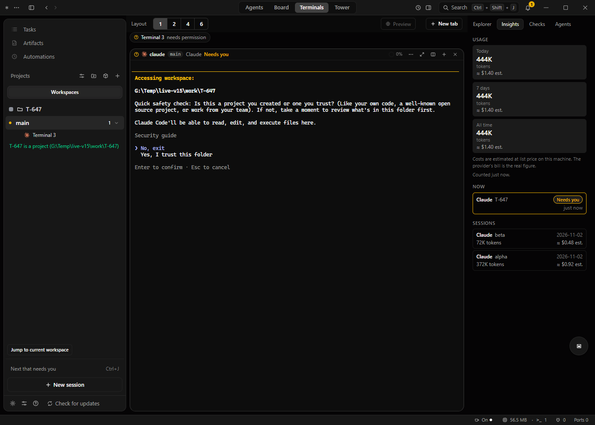
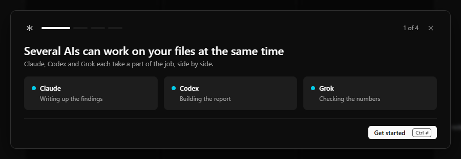
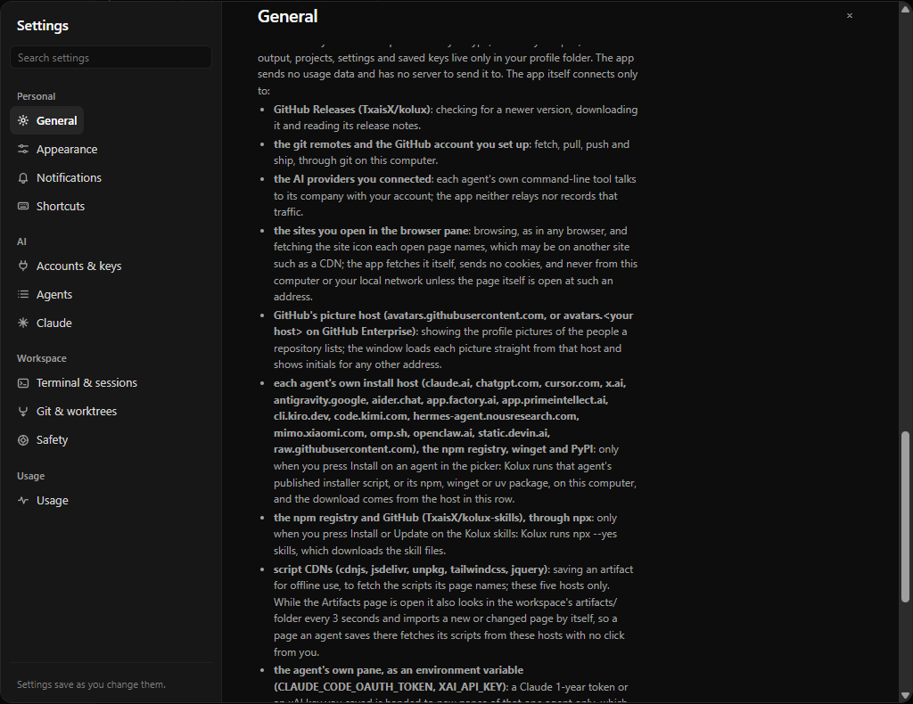

<p align="center">
  
</p>

<h1 align="center">Kolux</h1>

<p align="center">
  <strong>Run many AI coding agents side by side.</strong><br>
  Each one gets its own terminal, all in your project's folder.
</p>

<p align="center">
  <a href="https://github.com/TxaisX/kolux/releases/latest">Download the latest build</a> ·
  <a href="docs/guide/README.md">User guide</a> ·
  <a href="docs/STATUS.md">Status</a> ·
  <a href="https://github.com/TxaisX/kolux/issues">Issues</a>
</p>

<p align="center">
  <a href="https://github.com/TxaisX/kolux/actions/workflows/ci.yml"></a>
  <a href="https://github.com/TxaisX/kolux/releases/latest"></a>
</p>

Kolux is a Windows desktop app for people who run several AI coding agents at once. It starts Claude Code, Codex, Gemini CLI, and 30+ other agent CLIs in a grid of real terminal panes. In a Git project, each agent you launch works in its own Git worktree (a separate copy of the project) on its own branch, so agents do not overwrite each other's files. To have every agent share the project's own folder instead, turn off **Own folder for each agent** in Settings, Git.

> **Early alpha.** Kolux is built and used daily on Windows 11, but it has not been tested by outside users yet. Keep your work in Git, expect breaking changes, and report what breaks. [Status](docs/STATUS.md) lists what is verified and what is still open.

<p align="center">
  
</p>
<p align="center"><sub>Claude Code is waiting for an answer. The same <b>Needs you</b> shows on the tab, the pane, the Insights panel and the bell, beside the token and cost figures.</sub></p>

<p align="center">
  
</p>
<p align="center"><sub>The first of the four first-run steps. The next three connect an AI, pick a project folder and start a session.</sub></p>

<p align="center"><sub>The screenshots on this page are captures of the app's own window from the project's live test runs; the originals are in <a href="evidence">evidence/</a>.</sub></p>

## What it does

- **Parallel agents in one folder, or a folder each.** Launch a Solo, Pair, Workbench, or Swarm lineup. By default each seat in a Git project gets its own Git worktree and branch. Turn off Own folder for each agent and every seat works in your project's folder; the chooser then warns that several AIs will edit the same files.
- **One window.** Terminals, an editor, and diffs sit in the same split layout. Web pages open in your own browser.
- **Status at a glance.** Claude Code, Codex, Gemini CLI, and other agents report their own state through hooks. Working, needs you, stopped, and done use one vocabulary across the pane, Board, Inbox, tray dot, and notifications.
- **Usage and limits.** Token and cost figures come from local Claude and Codex logs. Weekly plan limits show on the pill and pane gauges where the provider reports them.
- **Review and ship.** When an agent finishes, press **Review changes** on its Board card or Inbox row. That opens All Changes, where you read every changed file, then stage, commit, push, and pull. Pull-request checks show in the right panel's Checks tab.
- **Local first.** No telemetry. Keys are sealed with Windows DPAPI. The app talks to GitHub (Releases and API), your Git remotes, and the AI providers you connect; the full list is in Settings, General, Privacy.

## What is different

- **Windows first.** Kolux is built and tested on Windows 11: PowerShell panes on the Windows console, an installer for your own Windows user, and updates whose signature the app checks before it installs them.
- **Measured, not guessed.** On the project's test PC, build 0.1.11 with 12 terminals open and the window minimised keeps 226 MB in memory and uses 5 % of one processor core, down from 544 MB and 13 %. The runs, the method and the gains that have not shipped yet are in the [footprint report](docs/research/kolux-slimdown-2026-11-09.md).
- **Your layout comes back.** Quit and reopen, and every project, tab and pane is where you left it, each terminal as a fresh shell in its folder. Nothing keeps running in the background after you quit. An idle agent can be put to sleep to free memory and woken into the same conversation.
- **Proof you can read.** More than 6,000 front-end tests and 3,000 Rust tests run on every push, 208 of the 228 must-have acceptance cards pass, and the ones still open are listed in [Status](docs/STATUS.md) rather than left out.
- **Every line is the project's own.** Kolux is a clean-room rebuild: written from a description of what the user sees, never from another app's code. [PROVENANCE.md](PROVENANCE.md) holds the record.

## Install

1. Open the [latest release](https://github.com/TxaisX/kolux/releases/latest) and download `Kolux_<version>_x64-setup.exe`.
2. Run the installer. It installs for your Windows user and adds the `kolux` command to your PATH.
3. Open Kolux. The first-run setup asks you to connect an AI, pick a project folder, and start a session.

**The installer is not code-signed yet.** Kolux is a free alpha and has no Windows code-signing certificate, so Windows treats the installer as from an unknown publisher. What you will see:

- **SmartScreen ("Windows protected your PC").** Choose **More info**, then **Run anyway**, after checking that you downloaded the file from this repository's Releases page. Right-click the file, open **Properties**, and the **Digital Signatures** tab will be absent; that is expected until signing arrives.
- **Smart App Control.** If Windows 11 has Smart App Control turned on, it can block an unsigned installer with no Run anyway button. Kolux cannot be installed on that PC until the installer is signed; Windows does not offer a one-off exception.
- **Updates are still checked.** The update manifest carries its own signature, and an installed Kolux verifies it before installing an update.

## Requirements

- Windows 11 x64 is the tested target. Windows 10 is not yet verified end to end: resizing a terminal pane may cut up long lines there, and the installer says so before it installs.
- The WebView2 runtime. Windows 11 includes it; the installer can fetch it if it is missing, which needs an internet connection; on a PC without WebView2 and offline, install the runtime first.
- Git, for the changes view and for committing, pushing, and pull requests.
- At least one agent CLI. Kolux can install some agents for you; others you install first.
- Node.js for agents that are distributed through npm. If an agent's install fails because Node.js is too old, Kolux says which version the agent needs and how to update.

## First run

On first launch, a four-step dialog asks you to connect at least one AI, choose a project folder or skip, and open a session. You can reopen it later from Help, Onboarding. The [getting started guide](docs/guide/getting-started.md) walks through each step and the top bar.

## How it works

Kolux is a Tauri 2 app. The window is React and TypeScript; the core is Rust. Each pane is a real PTY running your shell or agent; panes run with the window and end when you quit. Agents report status through hooks that Kolux installs in the agent's own settings, or through a plugin or extension where the agent supports one. Reports go to a loopback listener that requires a per-run token. There is no Kolux server.

## Privacy

Kolux has no telemetry, analytics, or crash upload. Your projects, settings, terminal output, and keys stay on your computer. Keys and managed sign-ins are sealed with Windows DPAPI at current-user scope. Feedback and crash reports open a pre-filled GitHub issue in your browser; nothing is sent until you submit it.

The full list of outbound connections is in Settings, General, Privacy and in the [safety guide](docs/guide/safety.md).

<p align="center">
  
</p>
<p align="center"><sub>Settings, General, Privacy lists every connection the app makes.</sub></p>

## Documentation

| Read | For |
|---|---|
| [User guide](docs/guide/README.md) | The full guide: setup, terminals, projects, reviewing changes, settings, CLI |
| [Getting started](docs/guide/getting-started.md) | First launch, the top bar, your first agent |
| [Status](docs/STATUS.md) | What is verified, what is missing, and what alpha means here |
| [Glossary](docs/GLOSSARY.md) | The words the app uses |
| [Safety](docs/guide/safety.md) | What Kolux guards and what it leaves to you |
| [Security policy](SECURITY.md) | How to report a vulnerability privately |
| [Architecture](docs/architecture/overview.md) | Processes, local doors, data, trust boundaries |
| [Architecture infographic](docs/architecture/architecture.svg) | The one-page visual map |
| [Development](docs/development/README.md) | Building, testing, releasing, code map |
| [Troubleshooting](docs/guide/troubleshooting.md) | Fix common problems and produce a safe report |
| [Command line](docs/guide/command-line.md) | Drive Kolux from a shell |
| [Feature index](docs/guide/feature-index.md) | Find a feature by name |

The [documentation home](docs/README.md) has the full index.

## Project

Kolux is in early alpha. The latest build is 0.1.11 (10 November 2026). The update feed is this repository's Releases page; installed copies check it automatically. Known gaps and verification status are in [Status](docs/STATUS.md).

Bug reports and feature requests go to [Issues](https://github.com/TxaisX/kolux/issues). If you want to propose a code change, open an issue first so we can agree on scope; read [CONTRIBUTING.md](CONTRIBUTING.md) before you start.

## Help test the alpha

Nobody outside the project has tested Kolux yet, so a report from a PC that is not the author's is the most useful thing you can send. It takes about ten minutes:

1. Install the latest build on Windows 11, and note what Windows says about the unsigned installer.
2. Go through the first-run setup: connect one AI, pick a project folder that is in Git, and start a session.
3. Launch two agents on different parts of a small job, and watch the Board and the Inbox while they work.
4. When one finishes, press **Review changes** and read what it changed.
5. Open an [alpha test report](https://github.com/TxaisX/kolux/issues/new?template=alpha-test.yml) and say where you got stuck. "Nothing broke" is worth sending too.

## Build from source

Requirements: Node.js 24, pnpm 12, Rust 1.90 or newer, the Tauri Windows prerequisites (WebView2 and the MSVC build tools), and Git.

```powershell
pnpm install
pnpm tauri dev
```

Build the installer with `pnpm tauri build`. Run the front-end tests with `pnpm test`. The Rust integration tests need scratch home folders, so run them under the provided environment:

```powershell
. .\scripts\test-env.ps1
cargo test
```

CI runs the full gate on every pull request and every push to `main`.

The full development docs are in [docs/development](docs/development/README.md): [building](docs/development/building.md), [testing](docs/development/testing.md), [releasing](docs/development/releasing.md), and the [code map](docs/development/code-map.md).

## License

Kolux is source-available. Copyright (c) 2026 Txais Xiong. All rights reserved. See [LICENSE](LICENSE). The source is public so you can read and review it; it is not open source. Notes on bundled third-party libraries are in [THIRD-PARTY-NOTICES.md](THIRD-PARTY-NOTICES.md).

Kolux is an independent project and is not affiliated with or endorsed by Anthropic, OpenAI, Google, GitHub, Microsoft, or the other agent vendors it can run.
