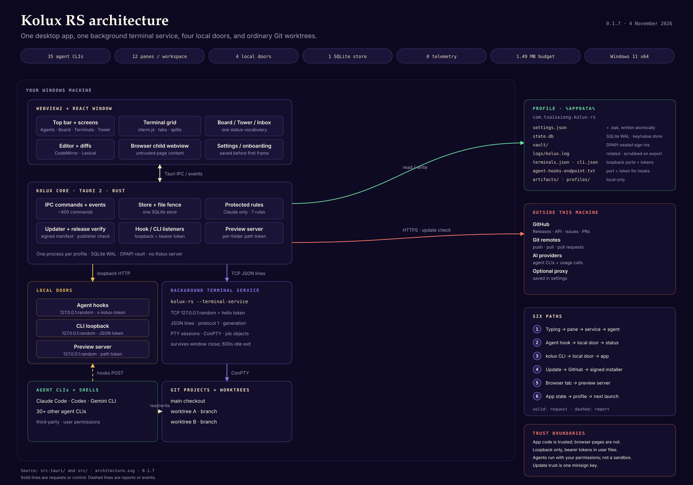

# Architecture overview

Kolux is a Tauri 2 desktop app for running many AI coding agents at once. The window is React and TypeScript. The core is Rust. A separate background process owns the terminals, and a small set of loopback listeners connects the window, the agent hooks, and the `kolux` command line.

This page follows the diagram from the outside in: processes, transports, local doors, storage, trust boundaries, and the update path. The deep dives are [Data](data.md), [Security](security.md), and [Frontend](frontend.md).

## Design in one page

- **One desktop app, one profile.** A single `kolux-rs.exe` owns the window, the store, and the local listeners. A named mutex keeps one copy per profile.
- **The terminal service is separate.** Panes run in a detached child process, so a window reload or an ordinary quit does not end the agents. The service exits after 600 seconds with no terminals and no attached window.
- **The control plane is local only.** The hook listener, the CLI loopback, the preview server, and the terminal service all bind `127.0.0.1` on random ports. Each requires a bearer token, and each refuses browser-shaped requests.
- **Worktrees are ordinary Git.** A workspace is a Git worktree on its own branch. Nothing about the repository format is proprietary.
- **The app is not a sandbox.** Agent CLIs are third-party programs running with the user's permissions. Kolux protects its own files, its own commands, and its own update path. It does not contain the agent.

## Processes

| Process | Role | Lifetime | Talks to |
|---|---|---|---|
| `kolux-rs.exe` | Tauri/Wry host: window, React UI, Rust commands, store, hook listener, CLI listener, preview server, updater | Starts with the app, exits on quit | The terminal service over TCP, the profile folder, GitHub Releases, Git |
| `kolux-rs.exe --terminal-service <identifier> <data folder>` | Detached terminal service: PTY sessions, pane processes, job objects | Survives window close and ordinary quit; exits after 600 s with no terminals and no attached window | The window over TCP; the OS PTY layer |
| `msedgewebview2.exe` | WebView2 browser and renderer processes for the main window and browser child webviews | Managed by Wry and Windows | The local app origin, browser pages |
| Agent CLI / shell | The user's shell or agent inside a pane | Child of the terminal service; dies with its pane job | Its own config, the workspace, the hook listener |
| `kolux.exe` / `kolux-dev.exe` | CLI client, one JSON request over loopback | One command, then exit | The desktop app's CLI listener |

A second launch of the desktop app does not open a second window. It takes the single-instance mutex, forwards `app.open` to the running copy, and exits with code 3 (`src-tauri/src/lifecycle.rs:79-124`, `:277-297`).

## Runtime topology

### Window to core

The React window calls Rust through Tauri commands and listens to Rust events. There are roughly 400 registered commands (`src-tauri/src/lib.rs:522-946`). The important event families are:

- `agent-status` for hook-driven state (`src-tauri/src/hooks.rs:23`);
- `terminal-output`, `terminal-exit`, and `terminal-screen-request` (`src-tauri/src/terminal.rs:17-21`);
- `settings-saved` (`src-tauri/src/lib.rs:168`);
- `cli-workspace` for commands that change what the window shows (`src-tauri/src/cli/mod.rs:50`);
- `update-progress` (`src-tauri/src/update.rs:311-317`).

The window never receives the sealed secret fields. Rust strips them before the settings payload reaches the page and ignores them on the way back (`src-tauri/src/secrets.rs:150-170`).

### Core to terminal service

The terminal service listens on a random loopback TCP port and writes `{port, token, pid, generation, protocol}` to `terminals.json` (`src-tauri/src/pty_service.rs:38`, `:510-520`). The wire format is one JSON object per line. A connection must start with a `hello` operation carrying the token and protocol 1, or it is refused (`src-tauri/src/pty_service.rs:11-13`, `:433-442`).

The window keeps one attached connection for output and exit events, and one control connection per terminal so a busy pane cannot block another (`src-tauri/src/pty_link.rs:1-13`, `:109`, `:350`). The generation number rejects typing meant for a service that has been replaced (`src-tauri/src/terminal.rs:35-58`). Output the window missed is rebuilt from `terminals-seen.json` on reattach (`src-tauri/src/terminal.rs:1539-1581`).

### Core to local doors

The hook listener, the CLI loopback, and the preview server are separate loopback doors with different authentication. They are described in [Local doors](#local-doors).

### Terminal service to panes

Each pane is a real PTY from `portable-pty`, backed by ConPTY on Windows (`src-tauri/src/pty.rs:204-260`, `:447-651`). Each pane's process tree sits in a Windows job object with kill-on-close, so closing the pane ends the shell and everything it started (`src-tauri/src/procs.rs:5-8`, `:309`). The terminal service itself is created outside the app's job with `CREATE_BREAKAWAY_FROM_JOB`, which is why it can outlive the app (`src-tauri/src/pty_service.rs:757-769`).

### App to storage

Everything lives under `%APPDATA%\com.txaisxiong.kolux-rs` (`src-tauri/src/resources/recovery.rs:849-851`). The important pieces are:

- `state.db`, one SQLite file in WAL mode with a single `kv(key, value)` table (`src-tauri/src/state.rs:36-41`);
- `settings.json` plus `.bak`, written to a temporary file and renamed (`src-tauri/src/state.rs:225-260`);
- `vault/`, one DPAPI-sealed file per managed sign-in (`src-tauri/src/secrets.rs:300-309`);
- `logs/kolux.log`, rotated and scrubbed for sharing (`src-tauri/src/diag.rs:4-23`);
- `terminals.json`, `cli.json`, and `agent-hooks-endpoint.txt`, the endpoint files for the local doors;
- `artifacts/`, `browser-profiles/`, and the managed Claude and Codex homes.

Hook scripts are not in the profile. They live in `~/.kolux-rs/agent-hooks` (`src-tauri/src/hooks.rs:30-36`), and each install writes a `.bak-kolux` copy beside the agent's own settings.

[Data](data.md) has the full table and the recovery behavior.

### App to outside

The app itself talks to GitHub Releases for updates and to the GitHub API for issues, pull requests, and checks. It uses git for the user's remotes and can call the Kimi and MiniMax usage endpoints when those providers are configured. Agent CLIs talk to their providers directly, using their own sign-in. There is no Kolux relay and no telemetry endpoint. The full outbound list is in Settings, General, Privacy and in the [safety guide](../guide/safety.md).

## Startup and shutdown

Startup is ordered so a broken profile cannot stop the window from appearing:

1. Install the panic hook and read the window configuration (`src-tauri/src/lib.rs:211-226`).
2. Register the dialog, updater, and notification plugins (`src-tauri/src/lib.rs:228-230`).
3. Take the single-instance claim; forward a second launch and exit (`src-tauri/src/lib.rs:232-234`).
4. Build the window through a retry that waits out a quitting predecessor still holding the WebView2 folder (`src-tauri/src/tools.rs:452-474`).
5. Create the app job object, resolve the data folder, set up diagnostics, repair the long-PATH hand-off, and sweep browser helpers (`src-tauri/src/lib.rs:238-245`).
6. Scan crash records, repair folder permissions, repair or restore `state.db` (`src-tauri/src/lib.rs:255-281`).
7. Open the store, unseal secrets, and start the recovery watch (`src-tauri/src/lib.rs:284-311`).
8. Create the `Terminals` state and start the service link (`src-tauri/src/lib.rs:340-342`).
9. Start the tray, artifact library, update state, Git detection, file fence, and orchestration upgrade (`src-tauri/src/lib.rs:344-370`).
10. Start the CLI listener, the hook listener, and the hook config sync (`src-tauri/src/lib.rs:373-389`).
11. Start the background loops: resume ticker, label and tidy pass, foreground status, activity save, quiet check (`src-tauri/src/lib.rs:405-460`).

Shutdown is equally deliberate. The exit path runs a final save, stops browser helpers, removes Grok hook entries it owns, lets go of the service's sessions so they keep running, ends any in-window sessions, waits up to 3 seconds for WebView2 to release the profile folder, removes the endpoint files, and installs a downloaded update if the exit was an update quit (`src-tauri/src/lib.rs:970-1006`). An update restart is different: it stops the terminal service so the installer can replace the program the service runs from (`src-tauri/src/terminal.rs:1609-1616`).

## Terminal and session lifecycle

1. A pane asks the window-side `Terminals` registry for a session (`src-tauri/src/terminal.rs:1039-1052`).
2. If the service link is up, the registry sends `spawn` over TCP. If it is not, the pane falls back to an in-window PTY, which is the development path.
3. The service creates the PTY, puts the process tree in a pane job, and returns a terminal id.
4. Output and exit events arrive on the attached connection. Control operations such as write, resize, and kill use the terminal's own connection.
5. On a window reload or a restart, `adopt` rebuilds the remote sessions from the service's rows (`src-tauri/src/terminal.rs:1539-1581`). The pane keeps its id, key, and scrollback tail.
6. Closing a pane kills its job tree. Removing a worktree ends its shells and refuses when one survives, unless forced.
7. When the service has no terminals and no attached window for 600 seconds, it exits (`src-tauri/src/pty_service.rs:40`, `:471-491`).

## Local doors

| Door | Bind | Authentication | Purpose | Refuses |
|---|---|---|---|---|
| Agent hook listener | `127.0.0.1:0` | `x-kolux-token`; pane identity in `x-kolux-pane`; optional `x-kolux-config` | Agent events and protected-command decisions | `Origin`, `Referer`, or `Sec-Fetch-*` headers; wrong Host; missing or wrong token; more than 64 requests in flight; bodies over 4 MiB |
| CLI loopback | `127.0.0.1:0` | `token` field in the JSON request, from `cli.json` | One JSON request per connection from `kolux` | HTTP request lines; wrong token; a newer CLI that the app does not understand |
| Preview server | `127.0.0.1:0` | 128-bit random path token per folder | Serve a local dev-server preview | Wrong Host; bad token; path escape; folder not in an open project; files over 32 MiB |
| Terminal service | `127.0.0.1:0` | `hello` operation with the token from `terminals.json` | PTY spawn, attach, write, resize, kill | Missing or wrong token; protocol older than the window supports |
| Artifact scheme | `kolux-artifact:` / `http://kolux-artifact.localhost` | Main webview only | Serve artifact files to the viewer | Any webview other than `main` |
| Label proxy | `127.0.0.1:4580` | None; label is in the Host header | Optional workspace label proxy, off by default | Non-loopback targets; `https` |

The important limit: these are **bearer tokens in user-readable files**. Any process running as the same Windows user can read `terminals.json` or `cli.json` and drive the terminal service or the CLI. That is a same-user trust model, not a defense against local malware. [Security](security.md) treats this explicitly.

## Data at rest

| Path | Format | Why it matters |
|---|---|---|
| `settings.json` | Pretty JSON, atomic rename, `.bak` | User preferences; seven fields are sealed |
| `state.db` | SQLite WAL, one `kv` table | Projects, worktrees, grants, drafts, orchestration, account lists |
| `vault/` | DPAPI-sealed blobs | Managed Claude and Codex sign-ins |
| `logs/kolux.log` | Text, rotated | Diagnostics; scrubbed before sharing |
| `terminals.json` / `cli.json` | JSON endpoint records | Loopback port and token |
| `agent-hooks-endpoint.txt` | One line, `port token` | What the hook scripts read |
| `artifacts/` | `library.json` plus one folder per entry | Artifact library |
| `browser-profiles/` | WebView2 user data | Browser tabs and logins |

The store is deliberately small: one SQLite table, with transactions for multi-key changes and a read-failure latch that refuses writes until a read succeeds (`src-tauri/src/state.rs:19-27`, `:109-138`). A corrupt database is set aside and the backup is restored; if that fails, the app opens a frozen scratch store rather than overwriting anything (`src-tauri/src/resources/recovery.rs:160-190`).

## Security boundaries

Four boundaries matter:

- **The window is trusted app code.** It runs from the Tauri asset origin with a strict CSP (`src-tauri/tauri.conf.json:28`). Browser tabs are child webviews showing untrusted pages; they are deliberately kept away from trusted origins (`src-tauri/src/browser.rs:1-10`).
- **The file fence is the app's file authority.** Reads and writes must resolve inside a project or worktree, or through an exact grant for a single picked file. Links, shares, other machines, and volume-GUID paths are refused before any disk call (`src-tauri/src/fence.rs:34-118`).
- **Protected commands are a warning, not a sandbox.** Seven built-in rules plus user rules make Claude Code ask before force-pushing main, dropping tables, deploying, and similar actions. Only Claude's Bash and PowerShell tools are covered (`src-tauri/src/protected.rs:44-52`).
- **Update trust is a single minisign key.** The app carries the public key compiled at build time and refuses an update whose manifest is not signed by it. A compromised signing key can push to every installed copy.

[Security](security.md) has the full model, including DPAPI, the preview server, DOMPurify, and the known limits.

## The window

The React app has no router. The current screen is a string union persisted in settings, and the window can also open full pages such as Settings, Inbox, Tower, Floor, Artifacts, and Skills (`src/chrome/TopBar.tsx:26-33`, `src/shell/useWindowSave.ts:33-45`).

State is one large `WindowBag` hook plus two React contexts. Settings are loaded once, updated through partial patches, and broadcast to every window as `settings-saved`. Layout is saved with a 400 ms coalescer and flushed before close (`src/shell/useWindowSave.ts:138-147`). Agent status flows through one derived `paneStatus` function into tabs, the sidebar, the Board, the Tower, the Inbox, notifications, and the taskbar badge (`src/board/chip.ts:73-109`, `src/status/useAgentStatus.ts:234-320`).

The terminal pane uses xterm.js with a WebGL renderer when available and a pool of at most six GPU contexts (`src/terminal/renderer.ts:30-83`). The editor uses CodeMirror 6 for source, Lexical for rich Markdown, and pdf.js for PDFs. Markdown is sanitized with DOMPurify (`src/editor/PreviewPane.tsx:33-78`).

[Frontend](frontend.md) has the module map and the state-flow detail.

## Updates

The feed is `https://github.com/TxaisX/kolux/releases/latest/download/latest.json` (`src-tauri/src/update.rs:24`). The app checks at startup and every 30 minutes, with backoff after a failure. It downloads the installer into memory, verifies the minisign signature, checks the Windows publisher against the running copy, and installs through the NSIS passive installer (`src-tauri/src/update.rs:243-380`, `:422-438`).

Before the installer runs, the updater hands the app's children out of the kill-on-close job so the installer can outlive Kolux (`src-tauri/src/procs.rs:148`, `src-tauri/src/update.rs:444-455`). If the install fails immediately, the app takes the children back (`src-tauri/src/update.rs:428`).

Current gaps: the installer itself is not Authenticode-signed, and the quit-to-install path is not proven end to end. Use **Restart to update** when the app offers it. [Status](../STATUS.md) tracks both.

## Build and release

The app is built with Vite and Tauri, tested with Vitest and Cargo, and released through `scripts/release.mjs` after a CI gate on the exact commit. The development docs cover the loop:

- [Building](../development/building.md)
- [Testing](../development/testing.md)
- [Releasing](../development/releasing.md)
- [Code map](../development/code-map.md)

## Limits and unverified areas

- Windows 11 x64 is the tested target. Windows 10 is supported in the app but not verified end to end.
- The P0 acceptance suite is at 206 of 228 cards. Most open cards are live-proof checks, not missing code.
- The hook listener and CLI loopback are bearer-token doors. A same-user process that reads the token files can use them.
- The app is not a sandbox for agents. The protected-command rules are a warning for Claude only.
- The update trust chain has one signing key and no published rotation or revocation path.
- There is no telemetry, but WebView2 performs its own startup checks to Microsoft, which the app cannot disable.
- macOS and Linux are not available.
